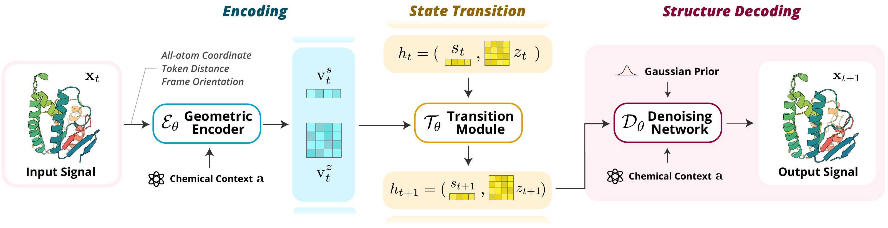

# ATMOS

This is the official repository for **Atomic Trajectory Modeling with State Space
Models for Biomolecular Dynamics**. **Accepted at NeurIPS 2026.**

[arXiv](https://arxiv.org/abs/2603.17633) · [NeurIPS](https://neurips.cc/virtual/2026/loc/sydney/poster/153486) · [BibTeX](#citation)

[](docs/figures/fig_main.pdf)

## Quick Start

On Linux with an NVIDIA GPU, Conda, Git, wget, GNU tar, and a C++ build toolchain,
run the following to generate a trajectory for the mdCATH test protein `2hsna01`.
The example uses the released models and precomputed MSA; allow approximately
7 GB of downloads and 15 GB of free disk space for assets. See the
[installation guide](docs/installation.md) for GPU requirements and setup details.

```bash
git clone https://github.com/VectorShi/ATMOS.git && cd ATMOS
conda create -n atmos python=3.11 -y && conda activate atmos
bash atmos/run_scripts/install.sh
bash atmos/run_scripts/download_example.sh
SOURCE_INDICES_CSV="${ATMOS_ROOT_DIR:-$PWD/atmos_oss}/examples/mdcath.csv" \
  CUDA_VISIBLE_DEVICES=0 GPUS_PER_NODE=1 bash atmos/run_scripts/mdcath_forward_simulation.sh
```

The launcher prints the log path. Trajectory predictions are saved under
`output/mdcath_inference/<run>/predictions/` as `.pkl.gz` files.

## Inference

Download the relevant weights, test data, and MSA using the
[asset instructions](docs/assets.md#download). The quick start already supplies
these assets for the full mdCATH test set. Run from the repository root in the
installed environment:

```bash
bash atmos/run_scripts/mdcath_forward_simulation.sh
bash atmos/run_scripts/misato_forward_simulation.sh --msa
```

Each command defaults to one GPU. Set `GPUS_PER_NODE=8` to distribute targets
across eight GPUs, or use the [parallel launchers](docs/assets.md#inference)
for two processes per GPU. Add `--dry-run` to inspect the launch command.

| Dataset | Coarse / fine models | Frame intervals | History windows |
| --- | --- | --- | --- |
| mdCATH | i20 / i1 | 20 ns / 1 ns | 20 / 30 frames |
| MISATO | i10 / i1 | 10 / 1 stored frames | 10 / 20 frames |

Both use protein MSA (up to 16,384 rows per recycling pass), `N_cycle=4`, a
5-frame stitching prefix, 50 diffusion steps, one sample, noise scale 1.5,
step scale 1.5, seed 42, and BF16. The fine models use destination conditioning,
which requires unit transition intervals; the initial destination horizon can
span multiple frames. MISATO uses 256-token spatial interface crops and also
accepts `--no-msa` for query-only features.

Inputs are prepared trajectory pickles, CSV indices, and sequence-indexed MSA
files. Use `SOURCE_INDICES_CSV=/path/to/subset.csv` to run a subset. The
[preprocessing guides](#training-and-data-processing) describe how to prepare
mdCATH and MISATO inputs. Dataset paths default to `atmos_oss/`, common
files to `af3-dev/`, and model weights to `atmos_oss/atmos_checkpoints/`.
Override `ATMOS_ROOT_DIR`, `PROTENIX_ROOT_DIR`, or `CHECKPOINT_DIR` as needed.

Inference outputs go to `output/mdcath_inference/` or `output/misato_inference/`.
Set `OUTPUT_ROOT_DIR` to change the output root. Each timestamped run includes a
`predictions/` directory for evaluation.

## Training and Data Processing

Use the [prepared training data](docs/assets.md#download), or prepare trajectories
following the [mdCATH guide](atmos/data/preprocessing/mdcath/README.md) and
[MISATO guide](atmos/data/preprocessing/misato/README.md). These guides describe
data splits, trajectory conversion, loader indices, and MSA inputs.

Download the [Protenix v0.5.0 initialization weights](docs/installation.md#protenix-initialization-weights-and-common-data)
before training. Launch each stage as a separate job:

```bash
bash atmos/run_scripts/finetune_mdcath_20ns.sh
bash atmos/run_scripts/finetune_mdcath_1ns_interp.sh
bash atmos/run_scripts/finetune_misato_i10.sh
bash atmos/run_scripts/finetune_misato_i1.sh
```

The models use a frozen 48-layer Pairformer with `N_cycle=4`. Training defaults
to eight GPUs on one node and writes to `output/`; use `GPUS_PER_NODE` and
`OUTPUT_ROOT_DIR` to change these settings. Changing the GPU count changes the
global training batch size. The launchers support `--dry-run` and distributed
settings through `NNODES`, `NODE_RANK`, `MASTER_ADDR`, and `MASTER_PORT`.
See the [training instructions](docs/assets.md#training) for stage parameters.

## Data and Evaluation

| ModelScope repository | Contents |
| --- | --- |
| [SmartVector/ATMOS](https://modelscope.cn/models/SmartVector/ATMOS) | Four inference weight files and matching YAML configurations |
| [SmartVector/ATMOS-dataset](https://modelscope.cn/datasets/SmartVector/ATMOS-dataset) | Prepared mdCATH and MISATO trajectories, indices, MSA, data splits, and mdCATH evaluation references |

Follow the [download and extraction instructions](docs/assets.md#download) for
full datasets. The [asset guide](docs/assets.md) describes directory layout,
split sizes, MSA coverage, and attribution. Download
[common dependencies](docs/installation.md#protenix-initialization-weights-and-common-data)
separately when preparing an environment without the quick-start helper.

Run evaluation on a completed inference run:

```bash
bash atmos/evaluation/mdcath/run_mdcath_evaluation.sh --work-dir /path/to/mdcath-run
bash atmos/evaluation/misato/run_misato_evaluation.sh --work-dir /path/to/misato-run
```

mdCATH requires the packaged ground-truth trajectories and reference structures.
MISATO uses reference trajectories stored in the prediction files. See the
[mdCATH](atmos/evaluation/mdcath/README.md) and
[MISATO](atmos/evaluation/misato/README.md) evaluation guides for metric
definitions, reference paths, parallel-run handling, and output files.

## Repository Layout

```text
ATMOS/
├── atmos/
│   ├── model/         # Dynamics model and trajectory conditioning
│   ├── runner/        # ATMOS training and inference
│   ├── run_scripts/   # Installation, downloads, and launch commands
│   ├── data/          # Trajectory loaders and preprocessing
│   └── evaluation/    # mdCATH and MISATO metrics
├── configs/           # Model and dataset configuration
├── docs/              # Installation and asset guides
├── protenix/          # Protenix model implementation
├── runner/            # Protenix runner entrypoints
├── scripts/           # Protenix helper scripts
└── requirements.txt   # Python dependencies
```

Runtime assets are stored in `atmos_oss/` and `af3-dev/` by default; these
directories are excluded from Git.

## License

ATMOS source code is licensed under the [Apache License 2.0](LICENSE), except
for third-party components with their own notices. In particular, the MISATO
[trajectory conversion script](atmos/data/preprocessing/misato/step_0_misato_h5_to_traj.py)
is licensed under LGPL-2.1-or-later. See [third-party notices](THIRD_PARTY_NOTICES.md)
for attribution and the applicable license texts. Copyright and license notices
from Protenix and other included projects are retained.
In ATMOS files, upstream copyright notices identify the corresponding
upstream-derived portions; they do not attribute ATMOS-specific contributions
to the upstream authors.

The source-code license does not assign a license to separately distributed
datasets, MSA files, model checkpoints, or common data files. See the
[asset licensing and attribution notes](docs/assets.md#licenses-and-attribution)
and the terms supplied with each distribution.

## Acknowledgements

ATMOS builds on [Protenix](https://github.com/bytedance/Protenix). We thank the
Protenix authors and contributors for their open-source implementation and
pretrained models. The model foundation is described in the
[Protenix paper](https://doi.org/10.1101/2025.01.08.631967).

We also acknowledge [OpenFold](https://github.com/aqlaboratory/openfold),
[OneFlow](https://github.com/Oneflow-Inc/oneflow), and
[FastFold](https://github.com/hpcaitech/FastFold) for components used by Protenix.
We thank the [mdCATH](https://huggingface.co/datasets/compsciencelab/mdCATH)
and [MISATO](https://github.com/t7morgen/misato-dataset) teams for their datasets
and data-processing tools.

## Citation
If you find this codebase useful in your research, please cite the following paper.

```bibtex
@inproceedings{
    shi2026atomic,
    title={Atomic Trajectory Modeling with State Space Models for Biomolecular Dynamics},
    author={Shi, Liang and Lu, Jiarui and Liu, Junqi and Shi, Chence and Yang, Zhi and Tang, Jian},
    booktitle={The Fortieth Annual Conference on Neural Information Processing Systems},
    year={2026},
}
```
